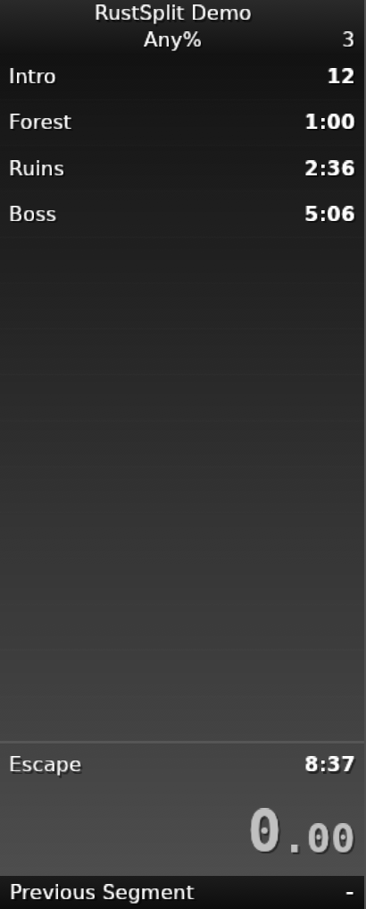
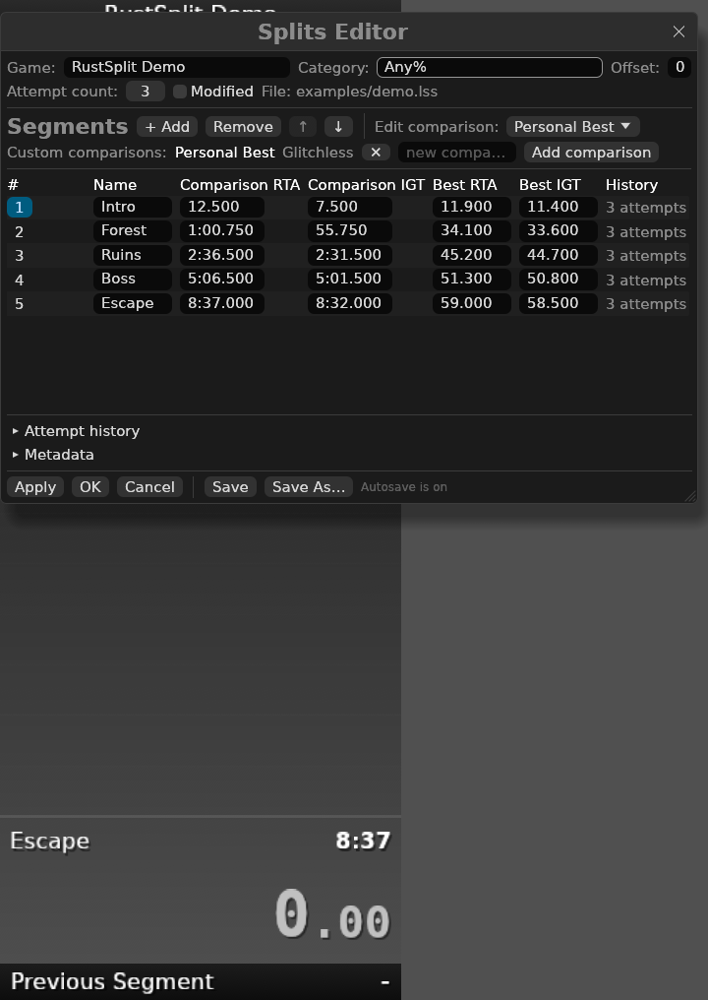

# RustSplit

A native Rust rewrite of [LiveSplit](https://livesplit.org), the speedrun timer.

RustSplit is a from-scratch Rust implementation of LiveSplit's timer model,
run format, comparison generators, layout system and remote-control protocol,
with an [egui](https://github.com/emilk/egui) desktop UI.

> **Status:** this is an independent rewrite, not a drop-in replacement for
> every LiveSplit plugin. Core timing, `.lss` split files, `.lsl` layouts,
> layout components and the LiveSplit Server protocol are implemented. Racing,
> video playback, auto-splitting runtimes and Speedrun.com integration beyond
> world records are not yet part of this rewrite.

<p align="center">
  
  
</p>

## Features

- **Accurate timer** with real time and game time, pauses, loading times,
  offsets, undo/skip, reset, and reset-and-set-PB.
- **LiveSplit `.lss` compatibility**: reads and writes LiveSplit 1.7 split
  files, including attempts, segment history, custom comparisons, metadata,
  icons and auto-splitter settings (preserved but not executed).
- **LiveSplit `.lsl` layouts**: reads existing layouts and writes layouts that
  use the same component paths and settings structure. The stock LiveSplit
  layout is bundled.
- **Layout components**: Title, Splits, Timer, Detailed Timer, Previous
  Segment, Delta, Sum of Best, Possible Time Save, Current Comparison,
  Current Pace, Run Prediction, Graph, Text, Separator, Thin Separator, Blank
  Space, Total Playtime, Counter, Hotkey Indicator, The Run, Comparison Time,
  Sum of Segments, World Record, Subsplits and Manual Game Time.
- **Comparison generators**: Personal Best, Best Segments (full sum-of-best),
  Best Split Times, Latest Run, Average Segments, Median Segments, Worst
  Segments, Balanced PB and None.
- **Splits editor** for games, categories, segments, PB times, best segments,
  custom comparisons and attempt history.
- **Layout editor** for adding/removing/reordering components, editing
  component settings, colors, fonts and global behavior.
- **LiveSplit Server**: TCP remote control on port 16834 with the classic
  command set.
- **Global hotkeys** (X11/Windows/macOS) and compositor key bindings through
  `rustsplit --command`.
- **Niri integration**: detects a Niri session, floats the overlay through
  Niri IPC and remembers its floating position and size.
- **Transparent, borderless, always-on-top overlay**, dynamic scaling,
  opacity, click-through-while-running, drag and resize. Transparency is
  optional per layout; transparent mode adds a high-contrast text outline and
  shadow so the timer stays readable over any background. Click-through is
  only enabled when global hotkeys, the LiveSplit Server or the local control
  socket (used by compositor bindings) are active, so the timer can still be
  controlled.
- **Sound effects** for splits, golds, personal bests, resets and other timer
  events, like LiveSplit's Sound Settings.
- **Transparent configuration** in `settings.toml`, recent runs and layouts.

## Building

Requires a Rust toolchain (1.95+; developed with 1.97) and the usual Linux
windowing libraries for `winit`/`glutin`. Sound effects need the ALSA
development headers (`alsa-lib`, `libasound2-dev` on Debian/Ubuntu); build
with `--no-default-features` to leave them out.

```bash
cargo build --release
./target/release/rustsplit
```

On NixOS this repository works with the standard Rust toolchain:

```bash
nix-shell -p cargo rustc --run 'cargo build --release'
```

Run the tests with:

```bash
cargo test
```

### Releases

Pushing a tag such as `v1.0.0` triggers the release workflow. It builds Linux
(x86_64 and aarch64), Windows (x86_64) and a universal macOS binary, then
publishes them with checksums on a GitHub release. The tag must match the
workspace version in `Cargo.toml`:

```bash
git tag -a v1.0.0 -m "RustSplit 1.0.0"
git push origin v1.0.0
```

The macOS binary is ad-hoc signed but not notarized, so Gatekeeper may require
opening it manually the first time.

## Usage

```bash
rustsplit                       # open the last run, or a blank run
rustsplit --splits MyRun.lss    # open a split file
rustsplit --layout MyLayout.lsl # open a layout
rustsplit --server --port 16834 # start the remote-control server
rustsplit --command startorsplit # control a running instance
```

Right-click the timer for the main menu. The window is borderless by default:
drag anywhere on the overlay to move it, drag the bottom-right corner to
resize, and use the context menu for everything else.

### Keyboard shortcuts

| Shortcut | Action |
| --- | --- |
| `Space` | Start / split |
| `R` | Reset |
| `Backspace` | Undo split |
| `Delete` | Skip split |
| `P` | Pause / resume |
| `U` | Undo all pauses |
| `Tab` / `Shift+Tab` | Next / previous comparison |
| `G` | Toggle real time / game time |
| `Ctrl+S` | Save splits |
| `Ctrl+Shift+S` | Save splits as |
| `Ctrl+O` | Open splits |
| `Ctrl+E` | Edit splits |
| `Ctrl+L` | Edit layout |
| `F1` | Settings |

Global hotkeys are disabled by default and can be configured under
**Settings → Hotkeys** using names like `F1`, `control+KeyS` or
`shift+alt+KeyR`. Global hotkeys use X11 on Linux. Wayland has no portable
global-hotkey API, so compositor key bindings use the local control socket
instead (see [Niri](#niri)).

### Niri

Niri is a scrollable tiling compositor, so RustSplit opens as a normal tiled
window unless it is floated. When RustSplit detects a Niri session through
`$NIRI_SOCKET`, it asks Niri to move its window to the floating layout and
stores the floating position and size under `[niri]` in `settings.toml`.
No window rule is required for this.

Niri floating windows sit above tiled windows. For games, use borderless
windowed mode if you need the overlay to stay visible over the game window.

To avoid even a brief tiled frame on startup, float the window immediately
with a Niri window rule. The Wayland application id is `rustsplit`:

```kdl
window-rule {
    match app-id=r#"^rustsplit$"#
    open-floating true
    // Niri otherwise fills transparent windows with the focus-ring gradient
    // while they are focused.
    draw-border-with-background false
}
```

Niri key bindings can drive the running instance over its control socket.
The commands are the same as the LiveSplit Server commands, plus `editrun`,
`editlayout` and `settings`:

```kdl
binds {
    Mod+Space       { spawn "rustsplit" "--command" "startorsplit"; }
    Mod+R           { spawn "rustsplit" "--command" "reset"; }
    Mod+BackSpace   { spawn "rustsplit" "--command" "undosplit"; }
    Mod+Delete      { spawn "rustsplit" "--command" "skipsplit"; }
    Mod+P           { spawn "rustsplit" "--command" "togglepause"; }
    Mod+Page_Down   { spawn "rustsplit" "--command" "switchcomparisonnext"; }
    Mod+Page_Up     { spawn "rustsplit" "--command" "switchcomparisonprevious"; }
    Mod+G           { spawn "rustsplit" "--command" "toggletimingmethod"; }
    Mod+Shift+E     { spawn "rustsplit" "--command" "editrun"; }
    Mod+Shift+L     { spawn "rustsplit" "--command" "editlayout"; }
}
```

Replace the bindings with ones that do not conflict with your Niri config.
The socket lives at `$XDG_RUNTIME_DIR/rustsplit/control.sock`;
`RUSTSPLIT_CONTROL_SOCKET` can override the path for testing.

### Sounds

RustSplit can play a sound file for each timer event: split, split ahead of or
behind the comparison, best segment, undo, skip, personal best, not a personal
best, reset, pause, resume and start. Choose the files and the volume under
**Settings → Sounds**, where **Test** plays a file. WAV, Ogg Vorbis, MP3 and
FLAC are supported. A split plays the most specific sound that is set: a best
segment falls back to the ahead/behind sound, and those and the final split's
personal best sounds fall back to the plain split sound. Like LiveSplit,
resetting a finished run is silent.

The settings are stored under `[sounds]` in `settings.toml`:

```toml
[sounds]
volume = 80
split = "/home/me/sounds/split.wav"
best_segment = "/home/me/sounds/gold.ogg"
personal_best = "/home/me/sounds/pb.mp3"
```

Files are decoded in the background and the audio device is opened the first
time a sound plays. If there is no audio device, RustSplit logs a warning and
carries on silently.

### Configuration

Settings live in the platform configuration directory, normally:

- Linux: `~/.config/rustsplit/settings.toml`
- Windows: `%APPDATA%\RustSplit\rustsplit\settings.toml`
- macOS: `~/Library/Application Support/org.RustSplit.rustsplit/settings.toml`

Pass `--config PATH` to use a different file.

### File dialogs

RustSplit opens and saves files with the system file chooser. On Linux that
is the XDG desktop portal, which needs, at runtime:

- `libdbus-1` and a D-Bus session bus,
- `xdg-desktop-portal`, plus a backend that implements the file chooser, such
  as `xdg-desktop-portal-gtk`, `-gnome` or `-kde`. `xdg-desktop-portal-wlr`
  has no file chooser, so pair it with `-gtk`.

If the portal is missing, `zenity` is used when it is installed. Otherwise
RustSplit falls back to its built-in file browser. Turn off **Use system file
dialogs** in Settings (`use_system_file_dialogs = false` under `[general]` in
`settings.toml`) to always use the built-in browser, or build without system
dialogs at all with `cargo build --no-default-features`.

### speedrun.com world records

The World Record component can show the current world record and its runners
from speedrun.com. This needs network access, so it is off by default: enable
**Settings → speedrun.com → Fetch world records from speedrun.com**, or set it
in `settings.toml`:

```toml
[speedrun_com]
fetch_world_records = true
```

Lookups only happen while the layout contains a World Record component. They
run in the background, are cached in memory and are refreshed hourly or when
the game, category, timing method or the component's platform, region and
variable filters change. The game and category come from the splits'
speedrun.com run id when present, otherwise from their names. Errors are
logged and the component keeps showing the last value (or `-`).

Building with `--no-default-features` leaves out the HTTP client entirely.

## LiveSplit Server

Enable the server in settings or launch with `--server`. It listens on TCP
port 16834 by default. Commands are newline-terminated and responses are
newline-terminated, matching LiveSplit's server. Examples:

```
startorsplit
split
reset
getcurrenttime
getcurrenttimerphase
getsplitnames
setgametime 00:01:23.45
```

The server implementation lives in `crates/rustsplit-server` and is covered by
protocol tests.

## Workspace layout

```
crates/
  rustsplit-core/    Timer, run model, time formatting, comparisons, .lss
  rustsplit-ui/      Layout model, .lsl, egui components and renderer
  rustsplit-server/  TCP protocol and command handling
  rustsplit/         Desktop application, editors, hotkeys, configuration
```

See [ARCHITECTURE.md](ARCHITECTURE.md) for a tour of the data flow.

## Compatibility notes

- `.lss` files are read and written in the LiveSplit 1.7 XML format. Generated
  comparisons are recomputed rather than stored, matching LiveSplit.
- `.lsl` layouts are read with legacy font blobs and component settings.
  RustSplit stores fonts it changes in a readable `Name|Size|Bold|Italic`
  form; unchanged LiveSplit font blobs are preserved byte-for-byte.
- Auto-splitter settings from `.lss` files are preserved but auto-splitting is
  not executed.
- The World Record component shows the speedrun.com record when
  [enabled](#speedruncom-world-records); otherwise it shows a "World Record" or
  "WR" comparison stored in the splits.
- UI-only Server commands (screenshots, hotkey-profile switching, auto-splitter
  paths) return safe no-op responses. `switchsplits` and `switchlayout` are
  handled by the application.
- Background images are supported from local files and from LiveSplit layouts
  that embed an image. Image blur uses LiveSplit's 0..1 scale relative to
  the image size and is applied once when the image or the blur changes.

## Credits

RustSplit is inspired by and compatible with
[LiveSplit](https://github.com/LiveSplit/LiveSplit) by Christopher Serr,
Sergey Papushin and contributors, and by
[livesplit-core](https://github.com/LiveSplit/livesplit-core). Both are MIT
licensed. The bundled DejaVu fonts are covered by the Bitstream Vera license;
see `crates/rustsplit-ui/assets/fonts/LICENSE-DejaVu.txt`.

RustSplit is not affiliated with the LiveSplit project. The LiveSplit name is
used only to describe format and behavior compatibility. The application icon
is original to RustSplit.

See [THIRD_PARTY_NOTICES.md](THIRD_PARTY_NOTICES.md) for asset, font and
reference-code attribution.

## License

RustSplit is released under the MIT License. See [LICENSE](LICENSE).
