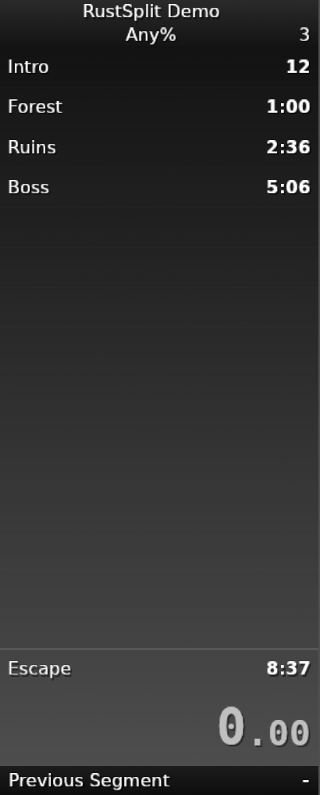
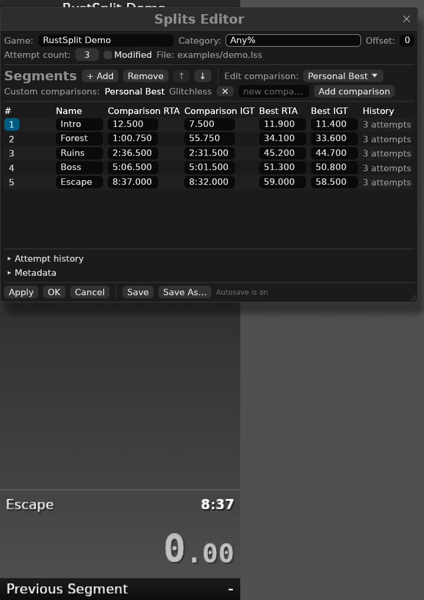

# RustSplit

A native Rust rewrite of [LiveSplit](https://livesplit.org), the speedrun timer.

RustSplit is a from-scratch Rust implementation of LiveSplit's timer model,
run format, comparison generators, layout system and remote-control protocol,
with an [egui](https://github.com/emilk/egui) desktop UI.

> **Status:** this is an independent rewrite, not a drop-in replacement for
> every LiveSplit plugin. Core timing, `.lss` split files, `.lsl` layouts,
> layout components and the LiveSplit Server protocol are implemented. Racing,
> video playback, auto-splitting runtimes, sounds and Speedrun.com integration
> are not yet part of this rewrite.

<p align="center">
  
  
</p>

## Features

- **Accurate timer** with real time and game time, pauses, loading times,
  offsets, undo/skip, reset, and reset-and-set-PB.
- **LiveSplit `.lss` compatibility**: reads and writes LiveSplit 1.7 split
  files, including attempts, segment history, custom comparisons, metadata,
  icons and auto-splitter settings (preserved but not executed).
- **LiveSplit `.lsl` layouts**: reads existing layouts and writes layouts that
  use the same component paths and settings structure. The stock LiveSplit
  layout is bundled.
- **Layout components**: Title, Splits, Timer, Detailed Timer, Previous
  Segment, Delta, Sum of Best, Possible Time Save, Current Comparison,
  Current Pace, Run Prediction, Graph, Text, Separator, Thin Separator, Blank
  Space, Total Playtime, Counter, Hotkey Indicator, The Run, Comparison Time,
  Sum of Segments, World Record, Subsplits and Manual Game Time.
- **Comparison generators**: Personal Best, Best Segments (full sum-of-best),
  Best Split Times, Latest Run, Average Segments, Median Segments, Worst
  Segments, Balanced PB and None.
- **Splits editor** for games, categories, segments, PB times, best segments,
  custom comparisons and attempt history.
- **Layout editor** for adding/removing/reordering components, editing
  component settings, colors, fonts and global behavior.
- **LiveSplit Server**: TCP remote control on port 16834 with the classic
  command set.
- **Global hotkeys** (X11/Windows/macOS) and keyboard shortcuts.
- **Transparent, borderless, always-on-top overlay**, dynamic scaling,
  opacity, click-through-while-running, drag and resize. Click-through is
  only enabled when global hotkeys or the LiveSplit Server are active, so the
  timer can still be controlled.
- **Transparent configuration** in `settings.toml`, recent runs and layouts.

## Building

Requires a Rust toolchain (1.95+; developed with 1.97) and the usual Linux
windowing libraries for `winit`/`glutin`.

```bash
cargo build --release
./target/release/rustsplit
```

On NixOS this repository works with the standard Rust toolchain:

```bash
nix-shell -p cargo rustc --run 'cargo build --release'
```

Run the tests with:

```bash
cargo test
```

## Usage

```bash
rustsplit                       # open the last run, or a blank run
rustsplit --splits MyRun.lss    # open a split file
rustsplit --layout MyLayout.lsl # open a layout
rustsplit --server --port 16834 # start the remote-control server
```

Right-click the timer for the main menu. The window is borderless by default:
drag anywhere on the overlay to move it, drag the bottom-right corner to
resize, and use the context menu for everything else.

### Keyboard shortcuts

| Shortcut | Action |
| --- | --- |
| `Space` | Start / split |
| `R` | Reset |
| `Backspace` | Undo split |
| `Delete` | Skip split |
| `P` | Pause / resume |
| `U` | Undo all pauses |
| `Tab` / `Shift+Tab` | Next / previous comparison |
| `G` | Toggle real time / game time |
| `Ctrl+S` | Save splits |
| `Ctrl+Shift+S` | Save splits as |
| `Ctrl+O` | Open splits |
| `Ctrl+E` | Edit splits |
| `Ctrl+L` | Edit layout |
| `F1` | Settings |

Global hotkeys are disabled by default and can be configured under
**Settings → Hotkeys** using names like `F1`, `control+KeyS` or
`shift+alt+KeyR`. Global hotkeys use X11 on Linux; Wayland sessions need a
compositor-supported global shortcut mechanism instead.

### Configuration

Settings live in the platform configuration directory, normally:

- Linux: `~/.config/rustsplit/settings.toml`
- Windows: `%APPDATA%\RustSplit\rustsplit\settings.toml`
- macOS: `~/Library/Application Support/org.RustSplit.rustsplit/settings.toml`

Pass `--config PATH` to use a different file.

## LiveSplit Server

Enable the server in settings or launch with `--server`. It listens on TCP
port 16834 by default. Commands are newline-terminated and responses are
newline-terminated, matching LiveSplit's server. Examples:

```
startorsplit
split
reset
getcurrenttime
getcurrenttimerphase
getsplitnames
setgametime 00:01:23.45
```

The server implementation lives in `crates/livesplit-server` and is covered by
protocol tests.

## Workspace layout

```
crates/
  livesplit-core/    Timer, run model, time formatting, comparisons, .lss
  livesplit-ui/      Layout model, .lsl, egui components and renderer
  livesplit-server/  TCP protocol and command handling
  rustsplit/         Desktop application, editors, hotkeys, configuration
```

See [ARCHITECTURE.md](ARCHITECTURE.md) for a tour of the data flow.

## Compatibility notes

- `.lss` files are read and written in the LiveSplit 1.7 XML format. Generated
  comparisons are recomputed rather than stored, matching LiveSplit.
- `.lsl` layouts are read with legacy font blobs and component settings.
  RustSplit stores fonts it changes in a readable `Name|Size|Bold|Italic`
  form; unchanged LiveSplit font blobs are preserved byte-for-byte.
- Auto-splitter settings from `.lss` files are preserved but auto-splitting is
  not executed.
- World Record data is not fetched from Speedrun.com by this rewrite.
- UI-only Server commands (screenshots, hotkey-profile switching, auto-splitter
  paths) return safe no-op responses. `switchsplits` and `switchlayout` are
  handled by the application.
- Background images are supported from local files and from LiveSplit layouts
  that embed an image. Image blur is stored but not applied by the renderer.

## Credits

RustSplit is inspired by and compatible with
[LiveSplit](https://github.com/LiveSplit/LiveSplit) by Christopher Serr,
Sergey Papushin and contributors, and by
[livesplit-core](https://github.com/LiveSplit/livesplit-core). Both are MIT
licensed. The bundled DejaVu fonts are covered by the Bitstream Vera license;
see `crates/livesplit-ui/assets/fonts/LICENSE-DejaVu.txt`.

RustSplit is not affiliated with the LiveSplit project. The LiveSplit name is
used only to describe format and behavior compatibility. The application icon
is original to RustSplit.

See [THIRD_PARTY_NOTICES.md](THIRD_PARTY_NOTICES.md) for asset, font and
reference-code attribution.

## License

RustSplit is released under the MIT License. See [LICENSE](LICENSE).
